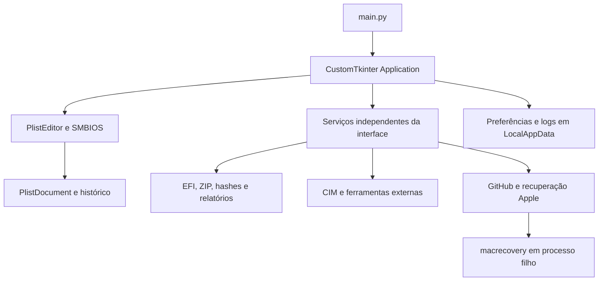

# Arquitetura 3.0.1

| Caminho | Responsabilidade |
| --- | --- |
| `main.py` | Entrada GUI, verificação de plataforma, smoke test e processo filho de recuperação |
| `openhelper/ui` | Interface CustomTkinter, Treeview de plist, formulário de valores, diálogo SMBIOS e fila de resultados |
| `openhelper/core/plist_document.py` | Tipos, mutações, histórico, fingerprint do arquivo e salvamento |
| `openhelper/core/validation.py` | Análise estrutural, caminhos relativos e inclusão de arquivos EFI |
| `openhelper/core/efi.py` | Localização de OC, backup/restore com hashes, extração e preparação de cópia de EFI |
| `openhelper/core/hardware.py` | Consultas CIM com comandos fixos e análise OHV conservadora |
| `openhelper/core/downloads.py` | Releases oficiais de uma lista fixa, download e verificação de tamanho/digest |
| `openhelper/core/recovery.py` | Parâmetros, supervisão, cancelamento e isolamento de macrecovery |
| `openhelper/core/process.py` | Execução sem shell de ocvalidate, OCAT e qemu-img |
| `openhelper/core/smbios.py` | Invocação de macserial, geração local de UUID/ROM e aplicação explícita |
| `openhelper/storage.py` | Preferências com defaults, recuperação de JSON corrompido e gravação atômica |
| `openhelper/i18n.py` | Idiomas de interface do Windows, prioridade de override e resolução de idioma |
| `locales` | Traduções en e pt-BR |
| `packaging` | Spec PyInstaller, metadados PE e instalador NSIS |
| `scripts` | Compilação, verificação de staging e teste real de widgets |

Operações de rede, hashing, backup, CIM e ferramentas externas rodam no executor. Resultados retornam por uma `queue.Queue`, consumida pelo loop principal; workers não chamam widgets. O download de recuperação usa um processo próprio para poder ser interrompido sem modificar a implementação original

O editor mantém o documento em memória e limita seu histórico a 50 estados. Alterações só chegam ao arquivo ao salvar. O SHA-256 do arquivo aberto detecta edições externas; o salvamento cria backup e faz substituição atômica no mesmo diretório. Chaves desconhecidas são preservadas; XML pode perder comentários e formatação, pois é serializado com plistlib

A inclusão de arquivos preserva entradas antigas, inclusive desativadas. Ordena dependências apenas entre novos kexts encontrados e não corrige a posição de dependências já existentes. A revisão e o ocvalidate continuam necessários

Arquivos ZIP são extraídos para uma pasta temporária e promovidos a um destino novo após sucesso. Traversal, symlinks, colisões sem diferença de caixa, aliases reservados do Windows e excesso de tamanho/arquivos são rejeitados. Backups exigem correspondência exata entre conteúdo e manifesto na restauração

